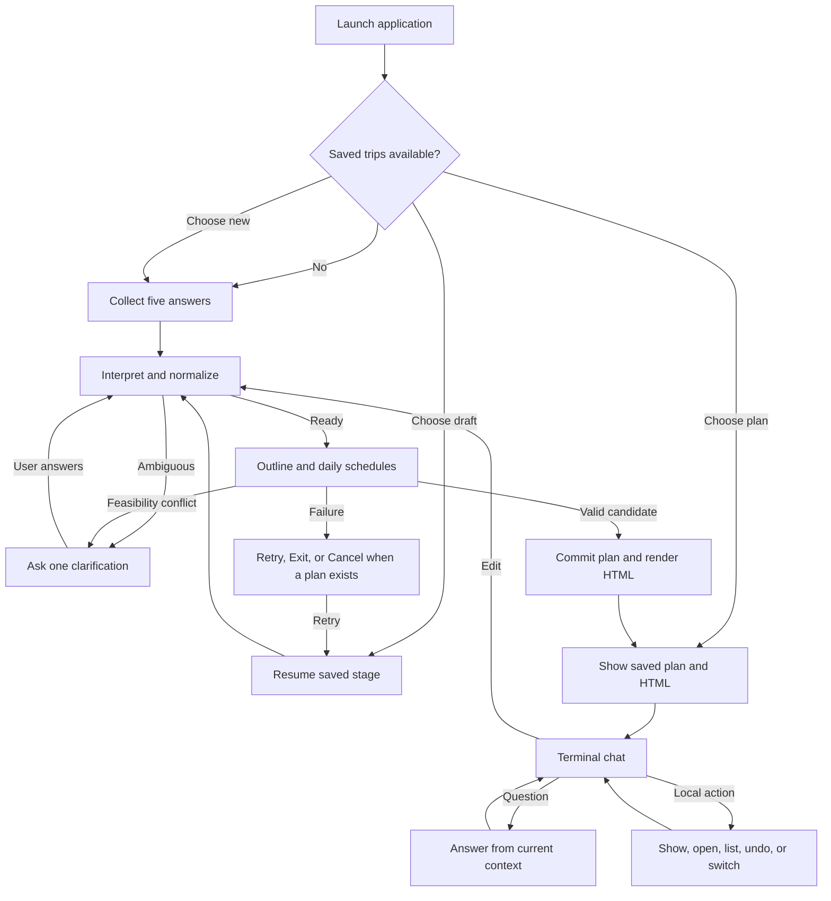
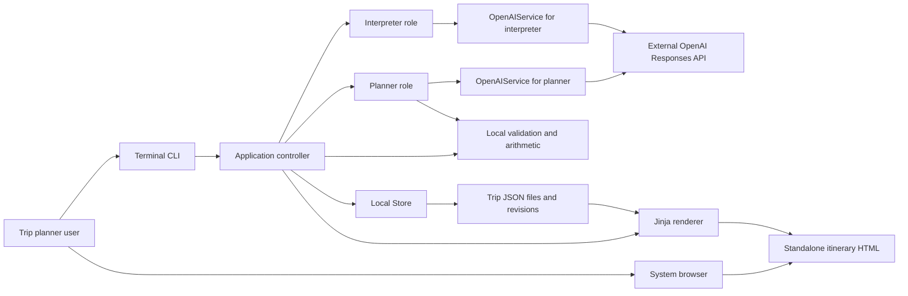
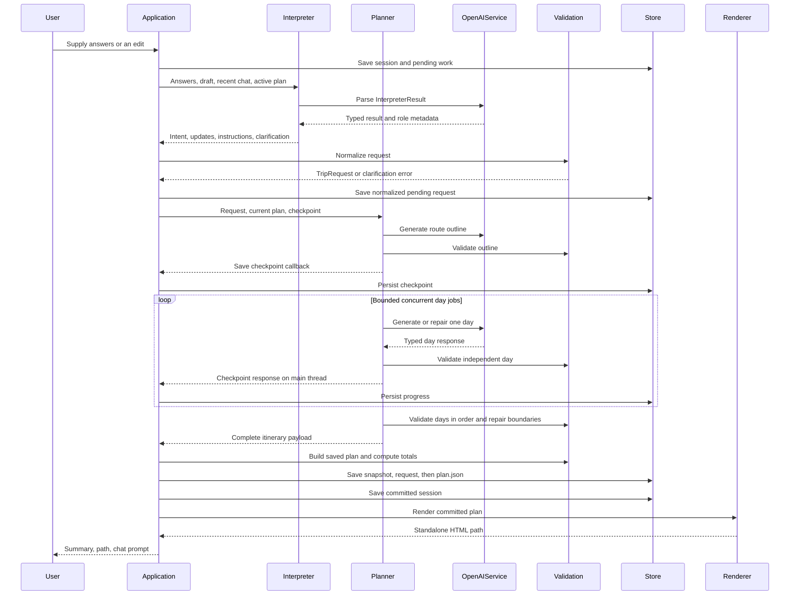
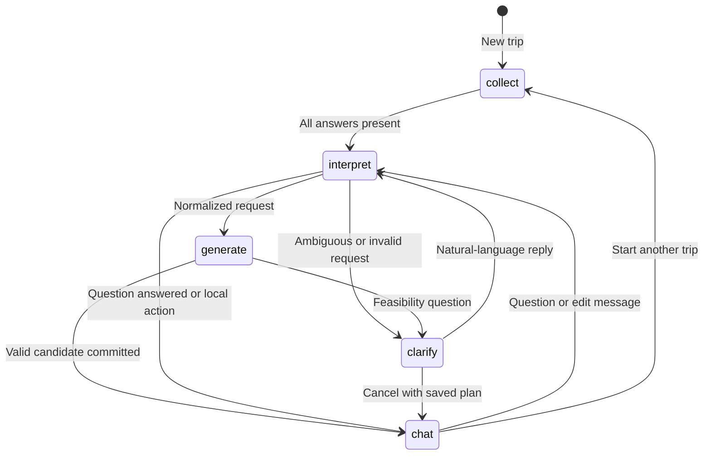
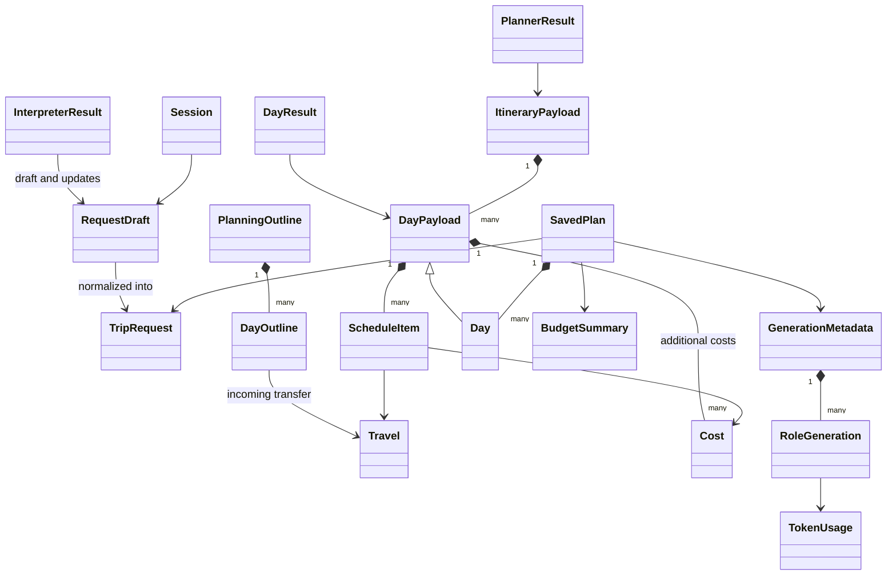

# Local Trip Planner — Project Manual

Version: **0.1.0** · Documentation date: **6 November 2026**

This manual describes the application implemented in this repository. It covers day-to-day use, supported cases, the technology stack, system and data design, and every application component. Behavior described as a prompt instruction depends on the model; behavior described as local validation is enforced by Python.

## Contents

1. [Project overview](#1-project-overview)
2. [Installation and configuration](#2-installation-and-configuration)
3. [User flows and use cases](#3-user-flows-and-use-cases)
4. [Technologies used](#4-technologies-used)
5. [System architecture](#5-system-architecture)
6. [Conversation and state design](#6-conversation-and-state-design)
7. [Planning, concurrency, and recovery design](#7-planning-concurrency-and-recovery-design)
8. [Data model and contracts](#8-data-model-and-contracts)
9. [Validation and business rules](#9-validation-and-business-rules)
10. [Storage and revision design](#10-storage-and-revision-design)
11. [Component reference](#11-component-reference)
12. [Security and privacy](#12-security-and-privacy)
13. [Operations, troubleshooting, and verification](#13-operations-troubleshooting-and-verification)
14. [Limitations and maintenance guidance](#14-limitations-and-maintenance-guidance)

## 1. Project overview

### 1.1 Purpose

Local Trip Planner turns a natural-language travel brief into a structured itinerary. A user describes the trip in a terminal, views a portable HTML itinerary in a browser, and returns to terminal chat to ask questions or change the plan.

The application combines AI-generated travel suggestions with application-controlled validation, cost calculations, local storage, and revision history. It supports **1–21 days** and keeps drafts, completed plans, and interrupted planning progress on the local filesystem.

### 1.2 Users and interaction surfaces

The intended user is an individual planning a trip for themselves or a group. The same person runs the application and controls the local files. There are no separate administrator, customer, or organization roles.

| Surface | User activity |
| --- | --- |
| Terminal questionnaire | Supply a trip name, duration, destinations, budget, and preferences. |
| Terminal chat | Ask questions, request edits, undo changes, select saved trips, and recover failed operations. |
| Standalone browser page | Read the schedule, travel details, costs, assumptions, warnings, and generation record. |
| Local files | Retain, back up, render, or inspect saved plans and revisions. |

The browser page is a generated document. Changes are entered in the terminal, then the user refreshes the page. The application does not run a web server.

### 1.3 Implemented capabilities

| Capability | Result |
| --- | --- |
| Guided collection | Five prompts, optional skips, previous-answer replacement, and draft saving. |
| Natural-language interpretation | Structured trip constraints, questions, edits, and clarification requests. |
| Itinerary generation | A shared route outline followed by independently generated daily schedules. |
| Scheduling checks | Local times, timezones, durations, chronological order, transfers, meals, and rest. |
| Budget reporting | Group-wide itemized estimates, day totals, category totals, and budget status. |
| Refinement | Complete validated revisions, with unchanged days reused when eligible. |
| Recovery | Saved responses and ordered progress survive retries and restarts. |
| History | Revision snapshots and local undo without an AI request. |
| Offline viewing | Saved-plan rendering and an explicitly labeled deterministic demo. |

### 1.4 Scope and boundaries

The application produces travel estimates. It has no live booking, map, routing, weather, timetable, exchange-rate, or price integration. It neither makes reservations nor confirms availability.

The default estimate covers the **whole traveling group across the whole trip**, including accommodation, meals, activities, local transport, and transfers between requested destinations. Travel from home to the first destination and back from the last is excluded unless requested.

The deployment model is one local user and one writing process per trip. There is no account system, database server, cloud synchronization, or multi-user editing.

## 2. Installation and configuration

### 2.1 Requirements and installation

Use Python **3.11 or later**, a terminal, and a browser for the generated itinerary. Live interpretation and planning also require network access, an OpenAI API key, and access to a model supporting the Responses API with Structured Outputs.

Run from the project directory:

```sh
python3 -m venv .venv
source .venv/bin/activate
python -m pip install -e .
```

The package exposes both entry points:

```sh
python -m trip_planner
trip-planner
```

These reach the same CLI. The activation command above is for a POSIX shell; use the corresponding virtual-environment activation on other platforms.

### 2.2 Try the application offline

```sh
python -m trip_planner demo --no-open
```

This creates a three-day Tokyo/Kyoto sample with saved JSON and HTML. The command prints the generated paths. Open `itinerary.html` in a browser; omit `--no-open` to ask the system browser to open automatically. No AI request or API credential is required for the demo.

### 2.3 Configure live use

If `.env` does not already exist, copy `.env.example` to `.env`. Preserve existing credentials when editing it. Set at least:

```dotenv
OPENAI_API_KEY=your-api-key
OPENAI_MODEL=your-structured-output-model
TRIP_PLANNER_TIMEZONE=Asia/Bangkok
```

There is **no hardcoded model default**. Select a compatible model available to the account. The interpreter and planner can use different models through their role-specific settings.

`Config.load()` reads `.env` from the **current working directory**. Existing environment variables take precedence. Relative output paths are also relative to the working directory. Launch from a consistent directory, or configure an absolute output path.

### 2.4 Configuration reference

Source: [config.py](trip_planner/config.py), [.env.example](.env.example).

| Setting | Default | Meaning and constraints |
| --- | --- | --- |
| `OPENAI_API_KEY` | Empty | Required for live AI operations. Hidden from the `Config` representation. |
| `OPENAI_MODEL` | Empty | Shared fallback model for both roles. |
| `OPENAI_EXTRACTOR_MODEL` | Shared model | Interpreter-specific model override. |
| `OPENAI_PLANNER_MODEL` | Shared model | Planner-specific model override. |
| `OPENAI_TIMEOUT_SECONDS` | `90` | Positive, finite network timeout setting; controls read inactivity. The SDK timeout uses the smaller of this and the request deadline. |
| `OPENAI_MAX_RETRIES` | `0` | SDK transient retries before a stream opens; integer `0`–`3`. |
| `OPENAI_REQUEST_DEADLINE_SECONDS` | `300` | Positive, finite elapsed-time guard for each AI step, checked between stream events. |
| `OPENAI_EXTRACTOR_MAX_OUTPUT_TOKENS` | `2000` | Positive output-token limit per interpreter response. |
| `OPENAI_PLANNER_MAX_OUTPUT_TOKENS` | `6000` | Positive output-token limit per outline, day, or repair response. |
| `OPENAI_REASONING_EFFORT` | `low` | Accepted locally: `none`, `minimal`, `low`, `medium`, `high`, `xhigh`, `max`; model support varies. Empty or `default` omits the API reasoning option. |
| `TRIP_PLANNER_WORKERS` | `3` | Concurrent daily generation jobs; integer `1`–`4`. `1` makes generation sequential. |
| `TRIP_PLANNER_TIMEZONE` | `UTC` | IANA timezone for interpreting relative dates. This differs from the Bangkok example in `.env.example`. |
| `TRIP_PLANNER_OUTPUT_DIR` | `output` | Root folder for saved trips. `--output-dir` takes precedence. |

The connection timeout is capped at the smallest of 10 seconds, the configured timeout, and the deadline. The deadline is not a hard wall-clock interrupt: a blocked read or initial SDK retries can extend elapsed time before the next event check.

Configuration is loaded at startup. After changing `.env`, restart the application, select the saved work, and use `Retry` if an operation is pending. Compatible checkpoints can be reused with changed transport settings.

## 3. User flows and use cases

### 3.1 Flow map



The diagram summarizes the experience. A resumed draft actually returns to its saved collection, clarification, interpretation, or generation stage; it does not always reinterpret from the beginning.

### 3.2 UC-01 — Create a trip interactively

**Precondition:** Live configuration is valid.

1. Run `python -m trip_planner` and select a new trip if the saved-trip menu appears.
2. Answer the five prompts in order:

   ```text
   Trip name (optional): Japan Food and Culture
   Days: three days
   Destinations: Tokyo first, then Kyoto
   Budget (optional): 75,000 yen for the whole group
   Preferences / special requests (optional): One traveler. Local food,
   temples and photography. Include Fushimi Inari and prefer trains.
   ```

3. The interpreter combines all answers, including details supplied under another label.
4. Resolve any material clarification.
5. The application normalizes the request, generates an outline and daily schedules, and validates the completed candidate.
6. The application saves revision 1, renders HTML, prints its absolute path, and enters chat.
7. Read the page and return to the terminal for changes.

**Result:** A trip directory contains the session, normalized request, authoritative plan, first revision snapshot, and generated page.

**Alternative cases:** Duration and destinations cannot be skipped. Optional blank answers do not trigger questions merely because they are omitted. An omitted trip name is derived from destinations and duration.

### 3.3 UC-02 — Correct answers, obtain help, or save a draft

| Input during collection | Behavior |
| --- | --- |
| Enter or `skip` on an optional prompt | Save an empty answer and continue. |
| Enter or `skip` on duration/destinations | Ask again for that required answer. |
| `back` | Move to the previous prompt and show its current answer. At the first prompt, explain that no earlier answer exists. |
| Replacement answer after `back` | Save the replacement; already supplied later answers are retained, and collection continues to the first unanswered field. |
| `help` | Show examples and stay at the current prompt. |
| `exit` or `quit` | Leave with saved progress available for the next launch. |

Accepted answers and prompt-position changes are saved immediately. A local write failure requires `Retry` after fixing permissions, or leaving with only previously saved progress recoverable.

### 3.4 UC-03 — Resolve missing or ambiguous details

Clarification can happen before generation or after the planner identifies a feasibility conflict. The application preserves the current draft and pending edit instructions.

| Case | Example | Expected handling |
| --- | --- | --- |
| Ambiguous budget currency | “Budget 5,000” or an ambiguous `$` amount | Ask for the currency; do not infer it solely from the destination. |
| Per-person budget without traveler count | “2,000 THB per person” | Ask how many people, then convert once to the group total. |
| Unclear place or local currency | A destination name with several plausible locations | Ask which location is intended. |
| Ambiguous date/duration | “Three nights” with no clear day count | Ask for the material missing decision. |
| Unsupported duration | 0 days or more than 21 days | Ask for a supported duration. |
| Conflicting constraints | Too many distant destinations for the available time | Offer a concrete decision, such as adding a day or reducing destinations. |

Only one concise clarification is requested at a time. Natural-language replies go through the interpreter with the pending context. A question asked during clarification should be answered without discarding that pending work; this distinction is part of the interpreter prompt.

### 3.5 UC-04 — Apply defaults and interpret group budgets

When the user supplies no optional constraints, the defaults are **one traveler**, **balanced pace**, **no budget limit**, and **numbered days without calendar dates**.

| Situation | Reporting behavior |
| --- | --- |
| Tokyo and Kyoto, no currency specified | Use their shared local currency, JPY. |
| Tokyo and Seoul, no currency specified | Use THB because the destinations use different currencies. |
| Explicit reporting currency | Use that currency; disclosed conversion assumptions belong in the plan. |
| Explicit amount with unclear currency | Ask for its currency before normalizing. |
| 10,000 THB per person, two explicitly stated travelers | Normalize to a 20,000 THB group budget. |
| Later change from two travelers to three | Preserve the existing group budget unless the user also changes it. |
| No known local currency and no explicit reporting currency | Ask for clarification. |

Currency inference and conversion estimates come from model interpretation/planning. Python selects the reporting currency and computes totals; it does not retrieve exchange rates.

### 3.6 UC-05 — Generate from an answer file

Create a UTF-8 text file with recognized labels:

```text
Trip name: Japan Food and Culture
Days: three days
Destinations: Tokyo then Kyoto
Budget: 75000 yen for the group
Preferences / special requests: One traveler, local food and temples.
  Include Fushimi Inari and prefer trains.
```

Run:

```sh
python -m trip_planner generate --text-file answers.txt --no-open
```

`Days:` and `Destinations:` labels must exist. `Preferences:` is also accepted; labels are case-insensitive and optional markers such as `(optional)` are removed. Nonempty unrecognized lines after a recognized label are appended to that answer, so use the documented labels. The parser reads labels; the interpreter extracts meaning.

**Result:** A saved draft starts at interpretation, then follows the same clarification, generation, validation, and chat path as an interactive trip. Missing required labels fail before generation.

### 3.7 UC-06 — Read, reopen, and print the itinerary

Use `Show my plan` for the terminal summary, or `Open the infographic` to regenerate the page from committed JSON and open it. `--no-open` suppresses automatic browser opening; an explicit chat `Open` action still asks the browser to open.

The page presents trip facts, day links, schedules, local timezones, transfers, item costs, additional day costs, day totals, the category breakdown, budget status, assumptions, warnings, and revision/generation metadata.

Use the browser's Print command to save a PDF. PDF creation is a browser operation, not a separate application export command. The HTML embeds its CSS and needs no server or external assets.

### 3.8 UC-07 — Ask a question without changing the plan

Examples:

```text
Why did you choose this neighborhood?
Would another day in Kyoto help?
What costs are included?
```

The interpreter receives the active plan and budget summary and returns a conversational answer. A question does not call the planner or create a new itinerary revision. Live questions still require API access. The response relies on the saved context and model knowledge, without live travel lookup.

### 3.9 UC-08 — Revise activities or trip constraints

Examples:

```text
Make Day 2 more relaxed.
Add Fushimi Inari to Day 3.
Change the trip to four days.
We are now three travelers; keep the same group budget.
Remove the spending limit.
Use numbered days instead of calendar dates.
```

1. The application saves the message and enters interpretation.
2. The interpreter returns explicitly changed request fields and itinerary instructions. Removing a budget or start date uses an explicit clearing field.
3. Python merges the updates and normalizes the request.
4. The planner creates a new outline and generates affected days. It can copy eligible unchanged days when the normalized request is exactly unchanged.
5. The application validates the complete replacement candidate and computes all totals.
6. The candidate becomes the next committed revision. A cost difference is displayed when the reporting currency is unchanged.
7. Refresh the same browser page to see the revision.

**Alternative cases:** A conflict asks for clarification. A failed edit preserves the last committed plan. Any change to the normalized request disables direct day reuse, even if the outline marks a day reusable. Reuse is an optimization, not a separate partial-plan format.

### 3.10 UC-09 — Cancel a pending change

Type `Cancel` during clarification or supported recovery. When a committed plan exists, the application clears pending work and restores the draft from that plan; the committed revision is unchanged.

For a new trip with no committed plan, cancellation clears pending instructions and clarification but retains the draft trip details. The user can describe what to change. Cancellation cannot reverse an already committed revision; use undo for that.

### 3.11 UC-10 — Undo a change

Type `Undo my last change` or `undo`.

If the current revision is greater than 1, the previous numbered snapshot is rebuilt and saved as a **new revision**. Restored content retains the same trip identity, while the revision number and update time advance. Undo uses local data and makes no AI request.

With no plan or at revision 1, the application reports that no previous revision exists. This is immediate-previous-snapshot restoration: repeated undo can alternate recent contents because each undo creates another revision. There is no separate redo stack or command to select an arbitrary revision.

### 3.12 UC-11 — Resume, switch, or create another trip

On startup, saved trips are listed as Draft or Plan, most recently updated first. Select the displayed number or a unique partial trip name. Multiple name matches require choosing a number; an unknown reference asks again.

In chat:

```text
List my saved trips
Continue my Japan trip
Start a new trip
```

Listing enters the selection flow. Resuming a committed plan validates and renders it without regeneration. A draft returns to its saved state. Interrupted interpretation or generation requires explicit `Retry`; the application does not silently replay requests.

Creating another trip first saves the current session and allocates a new trip identifier. Existing trips remain available.

### 3.13 UC-12 — Recover interrupted generation

If a request times out or fails, use `Retry` in the recovery prompt. After restarting, select the draft or plan and use `Retry` there.

Completed responses are checkpointed even when days finish out of order. For example, if Days 2 and 3 finish while Day 1 fails, their responses remain available; retry can generate or repair Day 1 and then validate the retained days in order.

The last committed plan remains authoritative throughout recovery. A compatible checkpoint resumes unfinished work; changing the request, instructions, planner model, or planning prompts invalidates it and starts fresh planning for that context.

### 3.14 UC-13 — Rebuild HTML without AI

```sh
python -m trip_planner render --plan output/TRIP_ID/plan.json --no-open
```

Replace `TRIP_ID` with the folder printed after saving. The command parses and validates the saved plan and writes `itinerary.html` beside it. It bypasses configuration loading and makes no API request. It does not update the plan revision.

For chat on an application-created plan:

```sh
python -m trip_planner chat --plan output/TRIP_ID/plan.json --no-open
```

Chat requires a file named `plan.json` inside a folder whose name matches its `trip_id`. It uses that folder's parent as the storage root.

### 3.15 Additional cases and outcomes

| Case | System response | User action |
| --- | --- | --- |
| Budget exceeded, otherwise valid plan | Save the estimate, show overage and tradeoff warnings. | Review or request cheaper choices. |
| Any unknown expense | Show known totals as partial and budget status as uncertain. | Resolve unknown expenses before relying on the budget. |
| Model returns a locally invalid day | Save the typed response and attempt one local repair. Ordered checks can require a separate boundary repair. | Use recovery if bounded repairs fail. |
| Planner says a trip is infeasible | Ask an actionable clarification; do not commit a partial itinerary. | Choose a constraint adjustment. |
| Network/authentication/model failure | Show a sanitized message and preserve saved work. | Fix the indicated issue; restart if configuration changed. |
| Plan save fails | Keep the validated candidate in memory and offer persistence retry. | Fix permissions and type `Retry`; leaving loses unsaved in-memory work. |
| HTML generation fails after commit | Keep committed JSON, mark rendering for retry. | Type `Retry` or run `render`. |
| Browser cannot open | Print the absolute HTML path. | Open the file manually. |
| Corrupt saved trip during discovery | Warn and skip that entry while keeping its files. | Inspect or restore the affected folder. |
| Output folder contains reports/unrelated folders | Ignore folders without a root `session.json` or `plan.json`. | No action required. |
| `Retry` during ordinary chat with no render failure | Report that no failed operation is available there. | Describe a change or use Help. |
| Exit, end of input, or keyboard interrupt | Attempt to save the session and leave. | Relaunch to resume previously saved work. |
| Local show/open/list/undo during an outage | Execute without an AI request, subject to valid local files. | Continue local work; live edits/questions require connectivity. |

## 4. Technologies used

Dependency ranges below are the declarations in [pyproject.toml](pyproject.toml), not a claim about a particular installed environment.

| Technology | Declared requirement | Role |
| --- | --- | --- |
| Python | `>=3.11` | Application runtime, CLI, orchestration, validation, storage, and rendering. |
| OpenAI Python SDK | `>=2.0,<3` | Synchronous Responses API streaming and Pydantic Structured Outputs. |
| HTTPX | `>=0.27,<1` | Network timeout configuration, transport error types, and mocked HTTP streams in tests. |
| Pydantic | `>=2.10,<3` | Typed AI contracts, saved documents, validation, serialization, and schema generation. |
| Jinja2 | `>=3.1.6,<4` | Render an autoescaped itinerary template. |
| python-dotenv | `>=1.0,<2` | Load local environment configuration without overriding existing variables. |
| Setuptools | Build requirement `>=75` | Package discovery, entry point, and inclusion of prompts, template, and CSS. |
| MarkupSafe | Transitive dependency used by rendering | Mark packaged CSS as trusted template markup. |
| HTML5 and CSS | Packaged assets | Semantic, responsive, printable browser itinerary. |
| JSON and UTF-8 text | Standard-library formats | Plans, sessions, revision snapshots, chat history, prompts, and answer files. |

Important standard-library facilities include `argparse`, `pathlib`, `zoneinfo`, `datetime`, `decimal`, `uuid`, `hashlib`, `concurrent.futures`, `queue`, `threading`, `tempfile`, `os`, `importlib.resources`, `webbrowser`, and `unittest`.

There is no frontend JavaScript framework, backend HTTP framework, database engine, task broker, or container requirement. Parallelism uses threads within the local process.

## 5. System architecture

### 5.1 Context and deployment



The CLI, application, interpreter, planner, validation, storage, and rendering code run in one Python process. The planner starts a bounded worker pool for day requests. The browser runs separately and reads a local file. OpenAI is the only application-level external service integration.

### 5.2 Layers and ownership

| Layer | Components | Owns |
| --- | --- | --- |
| Entry and configuration | `__main__`, `cli`, `config` | Arguments, environment settings, command selection, initial object construction. |
| Application interaction | `conversation.Application` | Session state, prompt collection, intent dispatch, history, recover/commit flow. |
| AI interpretation | `Interpreter`, interpreter prompt | Extracted language meaning, questions, explicit updates, clarification proposals. |
| AI planning orchestration | `Planner`, outline/day/rules prompts | Planning context, outline, per-day requests, reuse, checkpoints, bounded repair. |
| External API boundary | `OpenAIService` | Client initialization, streaming, structured parsing, metadata, sanitized errors. |
| Domain | `models`, `validation` | Contracts, request readiness, schedule consistency, application IDs, totals, budget status. |
| Persistence | `Session`, `Store`, atomic writers | Local files, discovery, snapshots, authoritative committed plan. |
| Presentation | `renderer`, Jinja template, CSS | Portable escaped HTML and browser-opening requests. |

Models propose travel content; Python decides whether it can be committed. Models do not own trip IDs, item IDs for new items, revision numbers, timestamps, arithmetic, file paths, or action execution.

### 5.3 Dependency construction

`cli.main()` loads configuration, constructs a `Store`, and supplies `Interpreter` and `Planner` instances to `Application`. Each role normally has its own `OpenAIService`; the planner's service shares one lazily created SDK client across its day workers.

`Application` also accepts replacement input, output, renderer, and browser functions. `Interpreter` and `Planner` accept replacement services. These direct dependencies allow deterministic offline checks without a dependency-injection framework.

Importing the package performs no API request or configuration load. SDK clients are created only when a live call needs them. Help, rendering, and the demo do not construct an SDK client.

### 5.4 End-to-end generation sequence



Clarification and error branches return before commit. The concurrent loop shows repeated work; network day calls may overlap while checkpoint writes remain on the main thread.

## 6. Conversation and state design

Source: [conversation.py](trip_planner/conversation.py), [storage.py](trip_planner/storage.py).

### 6.1 Session stages

`Session.stage` is stored as a string. The controller uses these stages:

| Stage | Meaning | Next step |
| --- | --- | --- |
| `collect` | Five labeled answers are still being collected. | Accept an answer, skip, back, help, or exit. |
| `interpret` | Answers or a pending chat message need language interpretation. | Interpret, dispatch an action, clarify, or prepare generation. |
| `clarify` | A detail or conflict needs a user decision. | Read chat; interpret a natural reply or dispatch a local action. |
| `generate` | A normalized request and pending instructions are ready. | Resume or begin planning, validate, and commit. |
| `chat` | A plan is ready for viewing and refinement. | Read questions, edits, and local actions. |



Exiting preserves the current stage. Recovery is an input loop around the saved operation, rather than a separate persisted stage. On restart, pending `interpret` and `generate` work waits for `Retry`.

### 6.2 Local actions and interpreted intents

Exact local phrases are matched case-insensitively after trimming. These actions bypass AI interpretation:

| Action | Accepted examples | Effect |
| --- | --- | --- |
| Help | `help`, `what can you do?` | Show examples. |
| Exit | `exit`, `quit`, `bye` | Leave and attempt session persistence. |
| Show | `show`, `show my plan`, `show the plan` | Print the saved-plan summary and warnings. |
| Open | `open`, `open the infographic`, `open my plan` | Regenerate HTML and ask the browser to open. |
| List | `list`, `list my saved trips`, `list trips` | Enter saved-trip selection. |
| Create | `new`, `start a new trip` | Save current work and begin a new draft. |
| Undo | `undo`, `undo my last change` | Restore the previous snapshot as a new revision. |
| Cancel | `cancel` | Clear pending changes. |
| Retry | `retry` | Resume within recovery; in normal chat, retry a failed render if marked. |

Chat also recognizes a `continue ...` prefix locally, removing an optional leading `my` and trailing `trip` to obtain the trip-name reference.

Other messages go to the interpreter. Its intent allowlist is `create`, `edit`, `question`, `list`, `resume`, `show`, `open`, `undo`, `cancel`, `help`, and `exit`. The controller maps these to fixed code paths. There is no model-generated command execution.

### 6.3 Request merge and pending state

For initial creation, the controller merges the interpreter's `request_draft`. For an existing plan, it merges only non-null values in `request_updates`. `clear_fields` explicitly clears `budget` or `start_date`; omission leaves a field unchanged.

`Session.pending` is an internal dictionary rather than a separate typed model. Keys used by the application include:

| Key | Purpose |
| --- | --- |
| `message` | User message awaiting interpretation. |
| `instructions` | Accumulated itinerary edit instructions. |
| `assumptions` | Interpretation assumptions to merge into the final payload. |
| `request` | Serialized normalized request for generation. |
| `base_revision` | Committed revision on which the pending operation began, or 0 for a new plan. |
| `generation` | Planner checkpoint, including responses and metadata. |
| `render_failed` | Marker allowing a later rendering retry. |

The interpreter receives only selected pending fields, not the potentially large generation checkpoint. Recent interpreter context is capped at 12 history messages; stored history itself is not capped. Interpreter metadata retains the latest 20 records in the session.

## 7. Planning, concurrency, and recovery design

Source: [planner.py](trip_planner/planner.py), [openai_service.py](trip_planner/openai_service.py).

### 7.1 Outline-first planning

The planner first requests a short `PlanningOutline`, combining the outline prompt with shared planning rules. The outline defines exactly one entry per requested day, explicit city boundaries, an overnight base, incoming intercity travel, and reuse decisions.

Local outline validation checks numbering, titles, destinations, nonempty boundaries, continuity with the previous day's end city, valid incoming transfer details, and requested destination order when place selection was not delegated. A city change requires an incoming transfer connecting that day's start and end cities.

A malformed outline gets one repair attempt. An outline clarification returns to the user before daily generation.

### 7.2 Daily generation and concurrency

Each day request includes the normalized request, shared outline, assigned day, neighboring outlines, edit instructions, and an existing day when available. During ordered repair, available fixed neighboring schedules are also supplied.

The planner uses `ThreadPoolExecutor` with at most `TRIP_PLANNER_WORKERS` active jobs. It submits only enough work to fill the available slots. Each worker:

1. Requests one `DayResult`.
2. Queues the typed response and per-call metadata immediately.
3. Checks independent-day rules.
4. If necessary, requests one repair with the candidate and validation feedback.
5. Returns success, clarification, or a failure.

Workers put progress and response events in `SimpleQueue`. The main thread drains the queue, invokes progress callbacks, changes checkpoint state, and persists it. Workers never write session files or directly control terminal output.

If any job fails or asks for clarification, the planner stops submitting additional jobs. It lets already-running jobs finish so successful out-of-order responses can be saved. Consequently, failure reporting may wait for other in-flight calls; they are not immediately terminated.

### 7.3 Ordered validation and repair

After fetching responses, the planner processes days in numerical order. It validates each day's outline relationship and the growing day prefix, detecting problems that independent jobs cannot see, such as overnight overlaps and cross-day transfer discontinuities.

A generated day's ordered failure receives one repair call in this pass. A reused day can receive up to two attempts in this pass. These ordered repairs are separate from a worker's one local repair; there is no single universal “one extra request per day” limit across every phase and user retry.

Validated days move from the ready-response cache to the ordered prefix. The final result is one complete `ItineraryPayload`, never a set of partial changes to the committed plan.

### 7.4 Reusing existing days

A day can be copied directly only when an existing plan is present, the entire normalized request equals the current request, and its outline entry has `reuse_existing=true`. This allows a targeted instruction-only edit to retain unaffected days.

A changed duration, budget, traveler count, date, destination, preference, title, or other normalized request field disables direct reuse. Copied days still pass ordered validation and may require a boundary repair.

### 7.5 Checkpoint structure and identity

The checkpoint lives in `session.pending.generation`:

| Field | Meaning |
| --- | --- |
| `identity` | SHA-256 of serialized planning context, planner model, checkpoint version, and active planning prompts. |
| `outline` | Validated serialized outline, when available. |
| `days` | Contiguous validated prefix of daily payloads. |
| `ready_days` | Map from day-number strings to received candidates not yet moved into the prefix. Candidates may still need validation or repair. |
| `metadata` | Successful parsed-call generation records used for aggregated usage. |
| `reused_days` | Day-number strings identifying copied days awaiting ordered processing. |
| `invalid_day` | Latest invalid candidate and feedback, when repair is pending. |

Checkpoint version 2 is included in the identity input. The context includes the validated request, current plan's planner-owned content, edit instructions, and supplied feedback. Planner model and active planning prompt changes invalidate a checkpoint. Timeout, worker count, retry count, token limits, and reasoning effort are outside this identity, so changing them does not by itself discard saved responses.

Checkpoints hold typed day responses, including invalid candidates. They do not hold partial streamed text or a resumable provider stream. A broken in-flight response must be requested again. Previously completed compatible responses can be reused.

### 7.6 Streaming, retries, and metadata

`OpenAIService.parse()` calls synchronous `client.responses.stream()` with a Pydantic `text_format`, serialized JSON input, explicit output limits, optional reasoning effort, and `store=False`. It consumes events and returns only a completed typed result.

Incoming events keep an active response from hitting a read-inactivity timeout. While events arrive, progress messages appear approximately every 15 seconds. A stalled stream can still hit the read timeout, and the elapsed-time guard is checked between events.

SDK retries are configured separately and default to zero. The application does not automatically replay a broken stream. Domain repairs are deliberate new requests, and user-selected `Retry` resumes a saved operation.

Client creation is protected by a lock. `last_metadata` is thread-local, preventing one worker's model/usage record from overwriting another's. Metadata includes provider, actual reported model, UTC time, requested reasoning effort, and token counts when supplied. Planner usage is aggregated across recorded successful parsed calls, including checkpointed calls from before a restart. It is not a complete billing ledger for failed or unrecorded requests.

## 8. Data model and contracts

Source: [models.py](trip_planner/models.py), [storage.py](trip_planner/storage.py).

### 8.1 Contract rules and relationships

Domain contracts derive from a shared Pydantic base that forbids unexpected fields and disallows non-finite numbers. Many nullable fields are still required in AI output; `null` expresses absence. `Session` separately forbids extra fields but uses ordinary dictionaries for pending state and history.



### 8.2 RequestDraft and TripRequest

| Field | Draft | Normalized request | Meaning |
| --- | --- | --- | --- |
| `trip_name` | Nullable string | String | Explicit or derived display title. |
| `destinations` | Nullable string list | String list | Requested ordered destinations. |
| `duration_days` | Nullable integer | Integer | Supported trip length after local checks. |
| `budget` | Nullable number | Nullable number | Draft may be per person; normalized value is the group total. |
| `currency` | Nullable string | String | Three-letter reporting code. |
| `destination_currencies` | Nullable string list | Not retained | Interpretation input for selecting a default currency. |
| `preferences` | Nullable string | String, default empty | Interests, constraints, origin, accessibility, transport, must-visits, and exclusions. |
| `start_date` | Nullable date | Nullable date | Explicit first calendar date, otherwise numbered days. |
| `travelers` | Nullable integer | Integer, default 1 | Number of travelers. |
| `pace` | Nullable enum | Enum, default `balanced` | `relaxed`, `balanced`, or `packed`. |
| `budget_per_person` | Nullable boolean | Not retained | Signals the one-time group-budget conversion. |
| `travelers_explicit` | Nullable boolean | Not retained | Distinguishes a user-specified count from a default. |
| `destination_delegated` | Nullable boolean | Boolean, default false | Whether concrete place selection was delegated. |

### 8.3 InterpreterResult

The interpreter response contains `intent`, `request_draft`, `request_updates`, `change_instructions`, `trip_reference`, `missing_required_fields`, `clarification_question`, `assumptions`, `assistant_message`, and `clear_fields`.

`request_draft` carries the merged partial request for creation. `request_updates` carries explicit constraint changes for an edit. `trip_reference` is a user-provided name/reference rather than a generated path. `clear_fields` contains only `budget` and/or `start_date` when explicitly removed.

### 8.4 Planning contracts

| Contract | Fields and meaning |
| --- | --- |
| `PlanningOutline` | `summary`, `days`, `assumptions`, `warnings`, `clarification_question`, `assistant_message`. Defines route-wide decisions. |
| `DayOutline` | `day_number`, `title`, `destinations`, `instructions`, `reuse_existing`, `start_location`, `end_location`, `overnight_base`, nullable `incoming_transfer`. |
| `DayResult` | Nullable `day` and nullable `clarification_question`; one daily result or a feasibility question. |
| `PlannerResult` | Nullable `itinerary`, nullable `clarification_question`, and `assistant_message`; internal handoff from planner to application. |
| `ItineraryPayload` | `summary`, `days`, `assumptions`, and `warnings`; planner-owned content before the persisted envelope is added. |
| `DayPayload` | `day_number`, nullable `date`, `title`, `summary`, `destinations`, `schedule`, `additional_costs`, and `notes`. |
| `Day` | All `DayPayload` fields plus application-computed `estimated_total_cost`. |

### 8.5 ScheduleItem, Travel, and Cost

| ScheduleItem field | Meaning |
| --- | --- |
| `id` | Nullable for new model output; stable application-owned identifier in saved plans. |
| `kind` | `activity`, `meal`, `travel`, `rest`, or `free_time`. |
| `title`, `description` | User-visible content. |
| `start_time`, `end_time` | Local 24-hour `HH:MM` strings. |
| `start_timezone`, `end_timezone` | IANA timezone names or supported explicit UTC offsets. |
| `start_day_offset`, `end_day_offset` | Nonnegative day offsets relative to the schedule's numbered day. |
| `duration_minutes` | Positive elapsed duration, checked against UTC-converted timestamps. |
| `place_name`, `location` | Nullable generally; required and meaningful for activities/meals. |
| `travel` | A `Travel` object for travel items; null for other item kinds. |
| `cost` | One itemized `Cost`. |
| `notes` | List of practical notes or disclosed assumptions. |

`Travel` contains `origin`, `destination`, `transport_mode`, positive `duration_minutes`, and `route_notes`. The scheduled block must allow at least that travel duration.

`Cost` contains `category`, nullable `amount`, `currency`, and optional `label`. Categories are `accommodation`, `food`, `transport`, `activities`, and `other`. **Zero means free; null means unknown.** Amounts apply to the entire group. Costs can appear on a schedule item or in `additional_costs`, such as a hotel estimate.

### 8.6 SavedPlan and BudgetSummary

`SavedPlan` is the authoritative document:

| Field | Meaning |
| --- | --- |
| `schema_version` | Current format is `1.0`. |
| `trip_id` | Safe local identity; preserved across revisions. |
| `revision` | Positive sequential committed revision number. |
| `created_at`, `updated_at` | UTC timestamps; creation time is retained across edits. |
| `request` | Complete normalized `TripRequest`. |
| `summary`, `days` | Validated itinerary content and computed day totals. |
| `budget_summary` | Application-computed category and trip accounting. |
| `assumptions`, `warnings` | Disclosed model assumptions plus application-generated notices. |
| `generation` | Provider/model metadata and role records. |

`BudgetSummary` contains `scope`, `category_totals`, `estimated_total`, nullable `budget_limit`, nullable `remaining`, `currency`, `status`, and `partial`. Its status is `no_limit`, `within_budget`, `over_budget`, or `uncertain`.

`GenerationMetadata` contains `provider`, nullable `model`, `generated_at`, nullable `usage`, `demo`, and `roles`. `RoleGeneration` records `role`, `provider`, nullable `model`, `generated_at`, nullable `usage`, and nullable `reasoning_effort`. `TokenUsage` holds nullable input, output, total, and reasoning token counts. Live commits put the aggregated planner record in `roles`; the top-level `usage` is not populated by the current application commit path.

### 8.7 Session

`Session` contains `trip_id`, `created_at`, `updated_at`, raw `answers`, `skipped` fields, `prompt_index`, `draft`, `stage`, nullable `clarification`, `pending`, `history`, and `interpretation_metadata`.

The session can exist without a plan, allowing draft collection and interrupted initial generation to resume. Session and plan timestamps serve different purposes: session activity can advance without creating a plan revision.

Pydantic models expose `model_json_schema()` if a schema export is needed. Runtime code does not depend on checked-in JSON Schema files.

## 9. Validation and business rules

Source: [validation.py](trip_planner/validation.py).

### 9.1 Request readiness

`normalize_request()` trims destinations, removes case-insensitive duplicates while preserving order, derives a missing title, trims preferences, and applies defaults. It requires a destination, duration of 1–21 days, positive traveler count, positive budget when present, and a three-letter reporting currency.

A stated budget requires its own currency. A per-person budget requires an explicitly supplied traveler count before multiplication. Once normalized, the controller resets the per-person flag so subsequent traveler-count edits do not multiply the group budget again.

Currency validation checks the three-letter format, not membership in an authoritative currency registry. Destination currency knowledge and linguistic date interpretation come from the interpreter.

### 9.2 Day and time validation

The completed itinerary must have exactly the requested number of consecutively numbered days. Dates must equal the start date plus the day index, or remain null for an undated trip. Every day needs a title, summary, destinations, nonempty schedule, at least one meal, and rest or free time.

Every schedule block needs a nonempty title and positive duration. Times must use `HH:MM`; offsets cannot be negative. Timezones are resolved, local times are converted to UTC, and elapsed seconds must equal `duration_minutes × 60`. Schedules cannot overlap, including across day boundaries.

Undated trips use a representative date beginning on 5 January 2026 for internal timezone arithmetic. A saved assumption explains that seasonal clock changes need confirmation. This provides consistent arithmetic without claiming the user selected those dates.

### 9.3 Destinations and transfer connections

Unless concrete destination choice was delegated, requested destinations need actual activity or meal visits in the expected order. Destination labels in day summaries alone are insufficient. Prompts require exact destination labels in meaningful location text so local coverage checks can recognize them.

Changes between different activity/meal places require travel segments. The first transfer must connect to the preceding visit, and the last must connect to the following visit. Consecutive route segments must connect; intercity changes require explicit scheduled transport.

An outline's incoming transfer can be represented as connected legs, such as hotel → airport → destination airport → hotel. Estimated travel minutes across the connected chain must meet the outline minimum. Waiting, rest, and extra block buffers do not count as travel minutes.

Location matching uses normalized text and narrow alias allowances, including reordered words for the same route endpoint. There is no geographic coordinate or distance calculation. These checks cannot establish that a proposed journey is physically realistic.

### 9.4 Cost calculations

All costs must be nonnegative and use the request's reporting currency. Python adds values using `Decimal(str(amount))`, then stores calculated totals as numeric model values.

```text
day total       = known schedule costs + known additional costs for that day
category total  = known costs assigned to that category across all days
trip total      = sum of category totals
remaining       = group budget - trip total, when a budget exists
```

| Condition | `status` | Other behavior |
| --- | --- | --- |
| Any cost is unknown | `uncertain` | `partial=true`; known sums remain visible with a warning. |
| All costs known, no budget limit | `no_limit` | Remaining amount is null. |
| All costs known, total at or below limit | `within_budget` | Display the remaining amount. |
| All costs known, total above limit | `over_budget` | Save the valid plan and add an overage warning. |

The model is instructed to include each expense exactly once. Local arithmetic sums supplied entries but does not recognize two semantically duplicated hotel or ticket charges. It also does not verify prices or exchange-rate conversions against external data.

### 9.5 IDs and persisted-plan integrity

`build_plan()` assigns new UUID item IDs and retains IDs that refer to known surviving items. If an edited item lacks an existing ID, it can match an unused old item by kind, title, and place name. Duplicate IDs are rejected.

The builder preserves trip identity and creation time, increments the revision, adds UTC timestamps, and assembles the computed budget summary. Undo can also recognize IDs from the restored snapshot.

`validate_plan()` rechecks schema version, revision, UTC timestamps, nonempty unique item IDs, itinerary rules, day totals, and budget arithmetic. It returns the original saved document after verification, preserving its IDs and metadata. A structurally valid JSON file with inconsistent totals is rejected.

## 10. Storage and revision design

Source: [storage.py](trip_planner/storage.py), [renderer.py](trip_planner/renderer.py).

### 10.1 File layout and authority

```text
output/
  <trip-id>/
    session.json
    conversation.json
    request.json
    plan.json
    itinerary.html
    revisions/
      0001.json
      0002.json
      ...
```

| File | Role |
| --- | --- |
| `session.json` | Resumable answers, stage, draft, pending operation/checkpoints, history, and interpreter metadata. |
| `conversation.json` | Readable mirror of session history under `messages`; not the source used to resume sessions. |
| `request.json` | Convenient copy of the normalized request for a plan save. |
| `plan.json` | **Authoritative committed revision**, containing its own request and computed totals. |
| `itinerary.html` | Derived view; rebuildable from committed JSON. |
| `revisions/NNNN.json` | Full saved-plan snapshot for each revision, with at least four digits in the filename. |

Back up the whole trip directory to retain checkpoints and undo history. The HTML alone is sufficient for reading/sharing, but not for application resume. Restoring only `plan.json` can reconstruct a basic chat session, but loses draft progress and stored conversation if the session is absent.

### 10.2 Atomic writes and commit order

Each JSON write creates a temporary sibling file, writes UTF-8 data, flushes and synchronizes it with `fsync`, then replaces the destination using `os.replace`. A failed write does not truncate an existing target. Rendering uses the same temporary-file replacement approach.

`Store.save_plan()` validates the candidate, then writes:

1. The numbered revision snapshot.
2. The request copy.
3. `plan.json` last, establishing the committed revision.

The controller subsequently updates the session and renders HTML. This is a file-level commit protocol, not one transaction covering every file. An interruption can leave a newer auxiliary request/snapshot or an older session/HTML beside the committed plan. Consumers should use the request embedded in `plan.json` as authoritative.

### 10.3 Restart reconciliation

When a loaded session has a pending `base_revision` older than the committed plan, the application treats that operation as already superseded and clears the stale pending work instead of repeating it. The direct resumed-session path also restores the draft from committed data.

If no session exists but a valid plan does, `Store.load_session()` constructs a basic chat session. Discovery only examines immediate nonsymlink directories that contain a root `session.json` or `plan.json`. Unreadable real trips produce warnings; unrelated folders are ignored.

### 10.4 Storage boundaries

`Store.directory()` allows only 1–80 characters from letters, digits, `_`, and `-`, and rejects a trip folder that is itself a symbolic link. Normal application IDs are generated locally. These checks limit accidental path traversal but do not create isolation from other processes that can modify local files.

There is no file locking, database transaction manager, or schema migration engine. Multiple writing processes can overwrite each other's state. Retain revision history when moving trip folders, and avoid simultaneous writers.

## 11. Component reference

### 11.1 Repository map

```text
README.md                         Quick start and operating summary
MANUAL.md                         This project manual
DOC.md                            Existing operating and technical reference
pyproject.toml                    Build metadata, dependencies, console command, assets
.env.example                      Configuration template
.gitignore                        Local credentials, environment, build/output exclusions
trip_planner/
  __init__.py                     Package identity and version
  __main__.py                     Module entry point
  cli.py                          Arguments and command composition
  config.py                       Explicit environment configuration
  conversation.py                 User interaction and application state machine
  interpreter.py                  Natural-language interpretation role
  planner.py                      Outline/day orchestration and recovery
  openai_service.py               External AI API boundary
  models.py                       Typed domain and AI contracts
  validation.py                   Request, schedule, identity, and cost rules
  storage.py                      Sessions, discovery, snapshots, atomic JSON
  renderer.py                     Standalone HTML rendering
  demo.py                         Deterministic offline fixture
  prompts/
    interpreter.txt               Active interpretation instructions
    outline.txt                   Active route-outline instructions
    day.txt                       Active per-day instructions
    planning_rules.txt            Active shared planning rules
    planning.txt                  Packaged full-itinerary prompt, currently unused
    revision.txt                  Packaged revision prompt, currently unused
  templates/itinerary.html.j2      HTML presentation structure
  static/styles.css               Layout, visual styles, responsive and print rules
tests/
  test_recovery.py                 Recovery, configuration, streaming regressions
  test_parallel.py                 Concurrency, boundaries, reasoning/metadata regressions
  test_transfers_storage.py        Transfer-chain and storage-discovery regressions
```

### 11.2 Package and CLI components

**[__init__.py](trip_planner/__init__.py)** declares package version `0.1.0` without doing I/O. **[__main__.py](trip_planner/__main__.py)** calls `cli.main()` and turns its return value into the process exit status.

**[cli.py](trip_planner/cli.py)** provides:

| Function | Responsibility |
| --- | --- |
| `parser()` | Define no-command interactive startup and `generate`, `chat`, `render`, `demo` subcommands. Accept `--no-open` and `--output-dir` globally or on subcommands. |
| `read_answers(path)` | Parse supported labels and continuation lines into the five answer fields; require duration and destination labels. |
| `open_page(path)` | Print an absolute HTML path, ask the browser to open it, and provide a manual-open fallback. |
| `main(argv)` | Compose configuration/storage/services, route the selected command, and handle safe terminal errors. |

`render` is dispatched before loading configuration. `demo` constructs fixture data and saves a chat-ready session. `generate` creates an interpretation-ready session from a file. `chat` validates the supplied application-created plan and selects its storage root. Normal startup enters saved-trip selection or a new questionnaire.

Successful commands return 0; handled file/configuration/validation failures return 1. Keyboard interruption/end-of-input is handled as a stopped session. Interactive recovery can end normally after preserving work, so exit status alone is not a complete success audit.

### 11.3 Configuration component

**[config.py](trip_planner/config.py)** defines immutable dataclass `Config` and user-facing `ConfigurationError`. `__post_init__()` validates timeouts, retry bounds, positive token limits, worker count, and accepted reasoning values. `load()` parses environment values with defaults and role fallback. `validate_live(role)` checks credentials, the relevant configured model, and the configured interpretation timezone without making a paid request.

New interactive trips validate both roles before collection. A role validates again when used. Offline operations do not require live credentials, although commands other than `render` still load and validate general numeric configuration.

### 11.4 Application controller

**[conversation.py](trip_planner/conversation.py)** contains the user workflow in `Application`:

| Method/group | Responsibility |
| --- | --- |
| `run()` | Main stage loop, resume reconciliation, safe AI/domain recovery, and exit persistence. |
| `select_trip()`, `new_trip()` | Discover/select saved work or allocate and save a fresh draft. |
| `collect()` | Five-prompt collection, skips, previous-answer replacement, examples, saving. |
| `chat()`, `dispatch()` | Match local actions, resolve local continue references, or queue natural-language interpretation. |
| `interpret()` | Call the interpreter, dispatch non-edit intents, merge updates, normalize, and prepare generation. |
| `generate()` | Supply planner context/checkpoint callbacks, handle feasibility questions, build a candidate. |
| `commit()` | Retry plan persistence, reset committed session state, report totals, render HTML. |
| `persist()`, `add_history()` | Save session state with write recovery and append selected messages. |
| `recover()` | Accept bounded user recovery actions without automatically replaying requests. |
| `cancel()` | Clear pending work and restore committed constraints when a plan exists. |
| `summary()`, `show_page()`, `say()` | Display summaries/warnings, regenerate the page, and format messages. |

`LeaveSession` is an internal control exception for leaving nested input/recovery flows. `PROMPTS`, `LOCAL_ACTIONS`, and `HELP` define the questionnaire and local command vocabulary.

### 11.5 Interpreter component

**[interpreter.py](trip_planner/interpreter.py)** loads the packaged interpreter prompt and constructs a JSON context containing the configured local date/timezone, labeled answers, current draft, user message, up to 12 recent history messages, active plan with budget summary, and selected pending-edit fields.

`Interpreter.interpret()` requests `InterpreterResult` from `OpenAIService` and exposes its metadata. It does not generate schedules, calculate totals, persist files, execute actions, or receive checkpoint internals. The interpretation timezone resolves relative language such as “next Friday”; schedule timezones belong to individual itinerary items.

### 11.6 Planner component

**[planner.py](trip_planner/planner.py)** coordinates the generation algorithm described in Section 7.

| Function/method | Responsibility |
| --- | --- |
| `plan_context(plan)` | Extract request and planner-owned itinerary fields, omitting storage envelope and computed totals. |
| `Planner.plan()` | Build context/identity, load or create outline, reuse days, fetch missing days, validate in order, aggregate metadata, return a complete payload. |
| `_fetch_days()` | Bound concurrent jobs, queue responses/progress, run local repairs, stop new submissions after failures, drain in-flight results. |
| `_validate_outline()` | Enforce route-boundary and destination-order requirements before generation. |

The outline and per-day models are the active API contracts. The planner internally returns `PlannerResult` to the controller after assembling the daily content.

### 11.7 OpenAI service component

**[openai_service.py](trip_planner/openai_service.py)** centralizes provider behavior:

| Element | Responsibility |
| --- | --- |
| `json_data()` | Serialize trip text as one JSON data message, retaining Unicode. |
| `OpenAIService._get_client()` | Lazily initialize the configured SDK client under a lock. |
| `OpenAIService.parse()` | Validate role setup, stream a structured response, enforce event-time checks, detect refusals/incomplete data, parse the contract, record metadata. |
| `last_metadata` property | Keep each thread's generation record separate. |
| `_incomplete_message()` | Give an actionable output-limit or incomplete-response message. |
| `AIServiceError` | Carry safe user-facing failures without displaying provider exception bodies or credentials. |

Handled failures include authentication/access, missing model, rate/quota limits, connection problems, read timeout, bad request, incomplete response, refusal, invalid structured output, early stream termination, and elapsed deadline. Role selection chooses the extractor or planner model and corresponding output limit.

### 11.8 Models and validation components

**[models.py](trip_planner/models.py)** defines the contracts in Section 8. Keep it as the source of truth for saved data and structured API results.

**[validation.py](trip_planner/validation.py)** contains:

| Function/group | Responsibility |
| --- | --- |
| `normalize_request()` | Resolve defaults and reject incomplete/invalid trip constraints. |
| `_zone()`, `_instant()` | Parse timezones, local times, and day offsets into UTC instants. |
| `_matches()`, `_route_matches()` | Normalize place text and apply route endpoint alias matching. |
| `_check_visit_connections()`, `_has_transfer_route()` | Check visit-to-visit transfers and multi-leg incoming journeys. |
| `_check_days()` | Check complete, prefix, or isolated-day schedule rules. |
| `validate_independent_day()` | Apply day-local schedule, outline, ID, cost, and route rules in workers. |
| `validate_day_outline()` | Tie a daily response to its assigned outline and incoming journey. |
| `validate_day_prefix()` | Check ordered progress, including cross-day rules and unique IDs. |
| `_cost_amount()` | Require reporting currency and nonnegative amounts; preserve unknown costs. |
| `build_plan()` | Validate a candidate, assign/reuse IDs, compute totals, add metadata and notices. |
| `validate_plan()` | Revalidate stored integrity and arithmetic without replacing saved identity. |
| `payload_from_plan()` | Extract planner-owned content while retaining item references. |

`MAX_TRIP_DAYS`, `COST_CATEGORIES`, and `BUDGET_SCOPE` centralize the supported duration, accounting categories, and default scope text.

### 11.9 Storage component

**[storage.py](trip_planner/storage.py)** defines `Session`, UTC timestamp creation, atomic text/JSON helpers, and `Store`:

| Method | Responsibility |
| --- | --- |
| `directory(trip_id)` | Validate a safe trip identifier and resolve its folder under the storage root. |
| `save_session()` | Update the session time and atomically write session and readable history files. |
| `load_session()` | Read a matching session, or reconstruct a basic one from a saved plan. |
| `save_plan()` | Validate and write snapshot, request copy, and authoritative plan in commit order. |
| `load_plan()` | Parse the plan, match its identity to the folder, and verify domain integrity. |
| `previous_plan()` | Load revision `current.revision - 1` for undo. |
| `list_trips()` | Discover immediate real trip folders, collect warnings, and sort by session update time. |

Missing or corrupt history can prevent undo even when the current plan is readable. Session history is stored in full; `conversation.json` is not an exhaustive transcript of every printed prompt or progress update.

### 11.10 Renderer and browser presentation

**[renderer.py](trip_planner/renderer.py)** supplies `_money()` for formatted amounts/Unknown, `_timestamp()` for UTC display, `render_plan()` for atomic HTML generation, and `open_plan()` as a browser-opening helper. Current CLI/controller paths open the browser through their own wrappers or injected function.

The renderer creates a Jinja environment using packaged templates and HTML autoescaping. It calculates category bar widths relative to the **largest category**, not as shares of the trip total. The budget-used bar is capped at 100%; text separately reports overage. Only packaged CSS is marked trusted markup.

**[itinerary.html.j2](trip_planner/templates/itinerary.html.j2)** defines the page title, masthead, trip summary/facts, demo notice, warnings, day navigation, daily timelines, route details, day accounting, budget sidebar, assumptions, preferences, and generation record.

**[styles.css](trip_planner/static/styles.css)** defines the paper/green/orange palette, typography, timeline and travel styling, desktop columns, narrower layouts at 1100/800/520 pixels, visible keyboard focus, reduced-motion handling, and print styles. Semantic headings, a skip link, labeled navigation, readable cost text, and decorative `aria-hidden` bars support accessibility; these features are not a formal accessibility conformance audit.

### 11.11 Demo component

**[demo.py](trip_planner/demo.py)** creates deterministic sample data with `_item()`, `_transfer()`, `_city_day()`, and `demo_plan()`. The fixture includes Tokyo visits, an intercity journey to Kyoto, meals, rest, accommodation, and explicit estimate warnings. It passes through the real normalization and `build_plan()` path.

The CLI assigns each demo run a fresh trip ID and clearly marks its generation metadata as a demo. Live generation never silently falls back to this fixture after an API error.

### 11.12 Prompt resources

| Resource | Active role and responsibility |
| --- | --- |
| [interpreter.txt](trip_planner/prompts/interpreter.txt) | Extract intent/constraints, preserve corrections and pending edits, resolve date/currency ambiguity, distinguish questions from edits, and return `InterpreterResult`. |
| [outline.txt](trip_planner/prompts/outline.txt) | Produce a short complete route outline with explicit boundaries, overnight bases, incoming transfers, and reuse decisions. |
| [day.txt](trip_planner/prompts/day.txt) | Produce only the assigned day, connect every visit/meal, follow route boundaries, preserve surviving IDs, and repair feedback. |
| [planning_rules.txt](trip_planner/prompts/planning_rules.txt) | Shared trust, schedule, cost, feasibility, and estimate-disclosure instructions appended to outline/day prompts. |
| [planning.txt](trip_planner/prompts/planning.txt) | Packaged full-itinerary role instructions; not read by the current execution path. |
| [revision.txt](trip_planner/prompts/revision.txt) | Packaged full-candidate revision instructions; not read by the current execution path. |

Current edits use the same outline/day pipeline with current-plan context and change instructions. Editing only the unused planning/revision prompts will not change the live planner's behavior.

### 11.13 Packaging, documentation, and test components

**[pyproject.toml](pyproject.toml)** declares package identity/version, dependency ranges, the `trip-planner` entry point, package discovery, and bundled prompt/template/CSS patterns. Runtime resources must remain inside `trip_planner` to be available after installation.

**[.env.example](.env.example)** provides placeholder configuration. **[.gitignore](.gitignore)** excludes credentials, virtual environments, caches, build products, and default generated output. A custom output folder needs its own ignore treatment if it is inside a tracked repository.

**[README.md](README.md)** provides the quick start; **[DOC.md](DOC.md)** provides the existing detailed reference; this manual adds the complete user/system/component guide. The three test modules are described in Section 13.

## 12. Security and privacy

### 12.1 Data sent externally

Live interpretation sends the trip answers, draft, message, bounded recent history, active itinerary/budget, and selected pending-edit context. Live planning sends normalized constraints, current itinerary context when editing, route/day instructions, and relevant repair candidates. Avoid entering trip information that should not be sent to the configured API service.

Requests set `store=False`. This describes the SDK request option; it does not by itself establish every aspect of provider retention or account policy. No other travel data service is integrated.

### 12.2 Local data and credentials

Credentials come from environment variables or local `.env`. The code does not intentionally include them in saved plans or HTML, and provider error bodies are not printed. `.env` and default generated output are ignored by version control.

Trip files and history are **unencrypted**. Anyone with filesystem access can read them. Exported HTML can reveal destinations, dates, preferences, group details, and costs. Review a page before sharing it. Sensitive information manually entered as trip text can still become part of stored or rendered content.

### 12.3 Trust boundaries

| Boundary | Implemented control | Practical limit |
| --- | --- | --- |
| User/model text → API instructions | Fixed system prompts and one JSON data message; prompt text treats trip content as untrusted. | Prompt adherence is model behavior; local validation remains necessary. |
| Model output → application state | Pydantic contracts and domain validation before commit. | Typed output does not prove factual travel accuracy. |
| Model intent → actions | Fixed intent/local-action allowlists. | Natural-language intent classification can still be mistaken. |
| Narrative → browser | Jinja autoescaping; only packaged CSS is trusted markup. | Local template/CSS changes are trusted application changes. |
| Trip identity → storage path | Restricted trip identifiers and rejection of a symlinked trip folder. | Not a sandbox against a hostile local user/process. |
| Failed generation → committed plan | Separate checkpoints and commit-last `plan.json`. | Auxiliary files/session/HTML are not updated in one transaction. |

The application does not execute model-generated code, shell commands, HTML, or JavaScript. It does not authenticate local users or encrypt backups.

## 13. Operations, troubleshooting, and verification

### 13.1 Command reference

```sh
# Guided startup or saved-trip selection
python -m trip_planner

# Do not open the browser automatically
python -m trip_planner --no-open

# Select another output root
python -m trip_planner --output-dir ./my-trips

# Generate from labeled answers, then chat
python -m trip_planner generate --text-file answers.txt --no-open

# Resume an application-created plan
python -m trip_planner chat --plan output/TRIP_ID/plan.json --no-open

# Validate saved JSON and rebuild its page offline
python -m trip_planner render --plan output/TRIP_ID/plan.json --no-open

# Create an offline sample
python -m trip_planner demo --no-open

# Show usage
python -m trip_planner --help
```

`TRIP_ID` is a placeholder for the actual printed folder name. No subcommand means interactive startup.

### 13.2 Troubleshooting

| Symptom | Likely cause | Recovery |
| --- | --- | --- |
| Missing key/model message | Live settings are absent. | Set `.env` or environment values, restart, select saved work. |
| Invalid timezone/configuration | Unsupported IANA name or out-of-range numeric value. | Correct the identified setting and restart. |
| Authentication/access denied | Invalid key or insufficient project/model permission. | Correct credentials/access and retry the saved operation. |
| Model unavailable | Model name or account access mismatch. | Choose an accessible compatible model; a planner-model change invalidates its checkpoint. |
| Bad request mentioning Structured Outputs/reasoning | Model incompatibility or unsupported reasoning setting. | Verify compatibility; use `OPENAI_REASONING_EFFORT=default` to omit reasoning. |
| Rate/quota limit | Provider rate or account quota/billing condition. | Resolve the account condition or retry later; fewer workers can reduce concurrency. |
| No response before timeout | Stalled network or generation stream. | Retry; if appropriate, increase the inactivity timeout and restart. |
| Active-step time limit | Event-checked elapsed guard reached. | Retry; adjust deadline if needed, then restart. |
| Output limit reached | The response could not finish within its token allowance. | Increase the named extractor/planner output limit, restart, and retry. |
| A day repeatedly needs correction | Model schedule/route output violates local rules. | Retry the saved candidate; revise constraints if the request is impractical. |
| Save/read permission error | Inaccessible file or output directory. | Fix the path/permissions; preserve the trip folder and retry the indicated write. |
| Invalid saved document | Corrupt schema, identity, timestamps, schedule, or arithmetic. | Restore a known-good backup; do not rely on manually changing totals. |
| Page shows an older plan | Browser has not refreshed, or rendering failed after commit. | Refresh, use `Retry` for a render failure, or run `render`. |
| Cannot resume an exported JSON copy with `chat` | File/folder naming does not match application storage conventions. | Use the original trip folder; `render` can validate/render a copied plan independently. |

### 13.3 Test design

The current repository has **48 offline regression tests**:

| Test module | Coverage |
| --- | --- |
| [test_recovery.py](tests/test_recovery.py) | Checkpoint/restart continuation, invalidation, unchanged-day reuse, constraint changes, bounded repairs, clarification, application commit behavior, interpreter context, configuration parsing, real SDK parsing over mocked HTTP streams, refusals, incomplete output, early stream end, read timeout, and deadline handling. |
| [test_parallel.py](tests/test_parallel.py) | Overlapping jobs, worker bounds, out-of-order persistence, draining after failure, local/boundary repair, retained checkpoints after worker changes, intercity outline constraints, route aliases, reasoning settings, thread-local metadata, and one-time client initialization. |
| [test_transfers_storage.py](tests/test_transfers_storage.py) | Connected airport chains, disconnected routes, actual travel minutes versus waiting, stale-session reconciliation, unrelated output folders, and corrupt-trip warnings. |

Tests use deterministic services, thread barriers/events, temporary directories, and mocked HTTP streams. They make no live API request. They verify important invariants but are not exhaustive coverage of every conversational utterance or browser layout.

Run after installing dependencies:

```sh
python -m unittest discover -s tests -v
```

An offline smoke check is:

```sh
python -m trip_planner --help
python -m trip_planner demo --no-open
python -m trip_planner render --plan output/TRIP_ID/plan.json --no-open
```

Inspect the printed page and verify the demo label, three-day schedule, transfers, totals, and printable layout. These checks exercise local behavior; they do not verify live model access or travel accuracy.

### 13.4 Verification for this manual

On 6 November 2026, the 48-test offline suite passed against the inspected source. CLI help and the documented offline demo/render/resume path were checked locally. No paid or live AI request was needed to prepare this manual.

## 14. Limitations and maintenance guidance

### 14.1 Current limitations

| Area | Limitation |
| --- | --- |
| Travel facts | Prices, travel duration, opening hours, access, and availability are estimates without live verification. |
| Geography | Place matching is text-based; route validation does not compute real distances or confirm transport services. |
| Money | Currency codes are format-checked; conversions and expense uniqueness depend on supplied content. Stored amounts/totals are numeric values, with Decimal used during summation. |
| Dates | Undated timezone arithmetic uses representative dates; seasonal transitions need review. |
| AI behavior | Interpretation, feasibility judgment, and travel quality depend on the model. Structured schemas and local rules cover only defined invariants. |
| Limits | Trips support 1–21 days and 1–4 concurrent day workers. |
| Recovery | Only completed typed responses are checkpointed; partial provider streams cannot resume. |
| Persistence | Per-file replacement, no cross-file transaction or concurrent-writer locking. |
| History | Snapshots can grow without pruning; undo restores only the immediate prior snapshot as a new revision. |
| Privacy | Local files are unencrypted and live operations transmit relevant trip information externally. |
| Product surfaces | Terminal editing and static HTML viewing; no browser editing, account system, synchronization, booking, or native PDF exporter. |

### 14.2 How to make common changes

| Desired change | Main places to update | Checks to consider |
| --- | --- | --- |
| Add a user command | `LOCAL_ACTIONS`, `Application.dispatch()`, interpreter intent contract/prompt if needed. | Offline routing, behavior without a plan, clarification/recovery interaction. |
| Add a trip constraint | Draft/request models, interpreter prompt/context, normalization, planning prompts/context. | Defaults, explicit update/clear semantics, storage compatibility, reuse/checkpoint effects. |
| Change schedule/cost rules | `models.py`, `validation.py`, active prompts, template if displayed. | Independent and ordered validation, computed totals, saved-plan integrity. |
| Improve itinerary quality | Active outline/day/shared rules prompts. | Route boundaries, required visits, bounded repairs, checkpoint invalidation. |
| Change page appearance | Template, CSS, renderer-derived display data. | Escaping, narrow widths, keyboard reading, unknown/partial costs, printing. |
| Add an API setting | `Config`, `.env.example`, `OpenAIService`, documentation. | Parsing/bounds, model compatibility, retry identity implications. |
| Change saved format | Models, Store, validation, schema-version handling, explicit migration strategy. | Old plan/session loading, revision history, interrupted operations. |
| Add packaged assets | Keep assets under the package and update package-data patterns. | Installation outside the repository, not only editable-source execution. |

After changing runtime assets or packaging, install a built package in a separate environment and exercise help, demo, rendering, and asset loading from outside the source directory. Keep user-facing documentation aligned with the actual active prompts and current contracts.

For a first code walkthrough, read `cli.py` → `conversation.py` → `models.py`/`validation.py` → `planner.py` → `openai_service.py` → `storage.py` → `renderer.py`, then examine the active prompts and regression tests.
